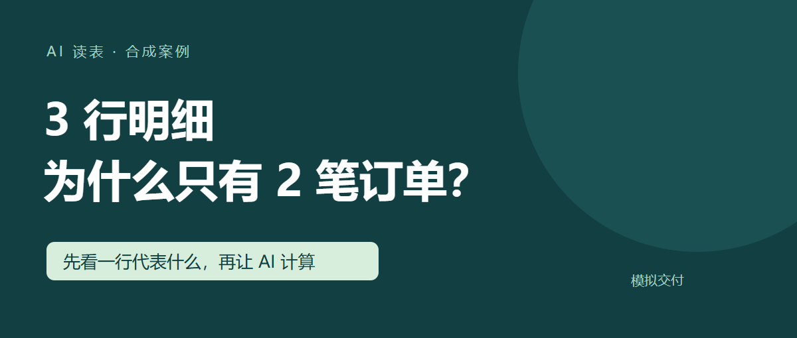
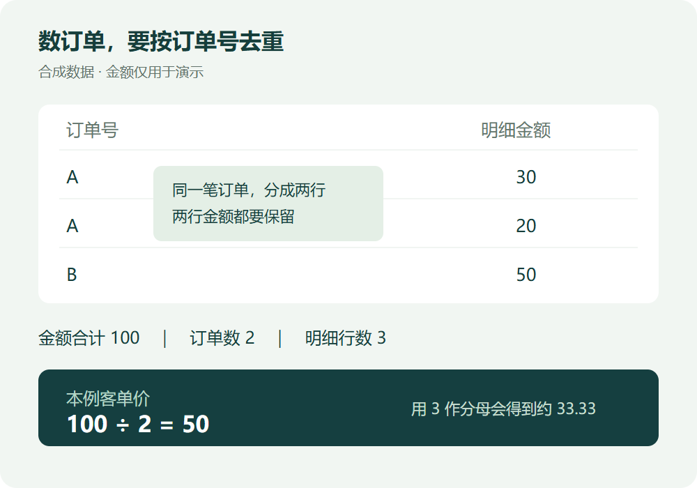

# 公众号模拟发布材料

- 交付状态：展示样式已获用户确认。
- 发布状态：未发布；未登录或操作公众号后台。
- 文章性质：合成案例、模拟交付，不能作为真实项目效果证明。
- 正文来源：[最终发布稿](001_订单分析_最终发布稿.md)。
- 标题：3 行明细，为什么只有 2 笔订单？
- 摘要：同一订单可能占多行。用三行合成数据，核对金额、订单数和客单价的计算口径。
- 封面：PNG，1200 × 510；仅为本次演示尺寸，未在公众号后台验证裁切。
- 正文配图：PNG，1000 × 700；放在“三行金额相加是 100”这一段之后。
- 阅读预览：[打开正文和流程记录](preview.html)。预览中的右栏只用于展示工作过程，不属于文章正文。

## 封面

## 正文信息图

## 交接检查

图片文件存在且可读取，数字与合成素材一致；独立浏览器已检查桌面和窄屏阅读。实际公众号排版、封面裁切、后台上传与发布均未验证。真实平台整包验收和发布授权仍需用户决定。
