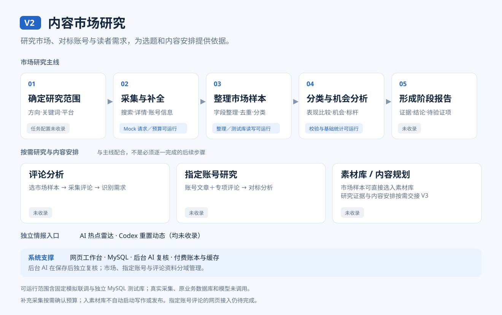
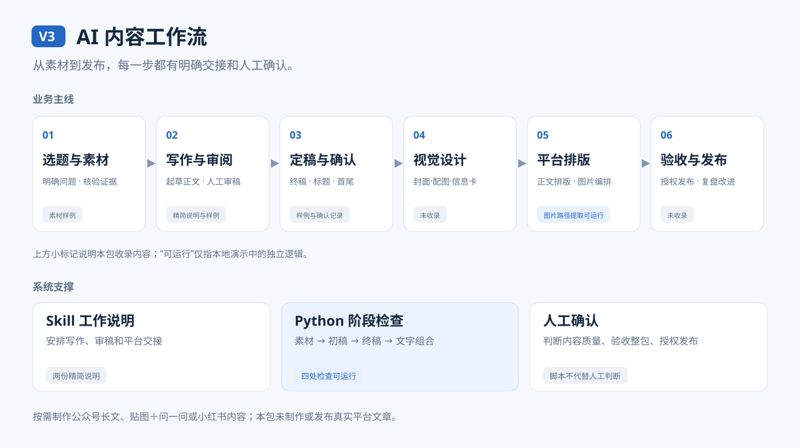

# 项目实现说明

本展示包从 AI 内容创作系统与 AI 内容工作流两个项目中选取部分实现。

两个项目分别处理内容创作中的两类工作：V2 帮助整理市场上的内容样本，研究选题方向；V3 组织从素材到定稿、再到公众号发布前准备的过程。以下先说明原项目怎样处理这些工作，再说明本包提供了哪些代码和验证结果。

图中展示原项目的完整业务主线，并在各环节标明本包范围：**可运行**指能用演示数据在本地执行；**片段**指供阅读的部分源码；**说明／样例**指精简工作说明或构造的测试材料；**未收录**指本包没有提供该能力。连线表示工作或资料的交接关系，不表示全程自动执行。

## V2：把零散内容整理成可比较的选题资料

### 业务问题

创作者做选题研究时，需要查找相关内容，记录主题、点赞、收藏和评论，再比较不同方向的表现。如果这些工作分散在浏览器和零散记录中，就需要反复查找、抄录和核对。

V2 的内容市场研究模块把收集、整理、分类和统计放在一个网页工作台中，为选题判断提供资料。本包选取小红书搜索相关实现，不包含完整研究报告或后续写作功能。

### 怎样处理

1. **按研究方向收集内容**。工作台通过第三方数据服务 TikHub 搜索小红书内容，取得文章信息和互动数据。
2. **整理成统一记录**。不同返回字段转换为一致的格式，数字文本转为数值；同一条内容重复出现时合并记录，并保留已有正文和人工分类。原项目还可补充详情、按规则初步分类，再通过保存队列写入 MySQL；这些步骤的完整代码没有全部收录。
3. **保存后再让 AI 复核分类**。模型任务在后台独立执行，检查结果后写回。即使 AI 暂时不可用，已保存的资料仍然保留，不必因此重新采集。
4. **按分类比较内容表现**。页面汇总每类的样本数、占比和互动中位数，为创作者判断哪些方向值得继续研究提供参考。统计描述的是所选样本，不能直接证明某个选题一定受欢迎。

本包可以在本地演示第 2 步中的数据整理、第 3 步中的结果检查，以及第 4 步中的基础统计。真实搜索、原模型调用、原数据库接口和完整网页保留为阅读片段。新增独立模拟联调实际使用本机 Mock API 与 MySQL 测试库，串联整理、分类校验、回写和统计；演示表与连接代码专为展示新建。

### 业务架构与流程总览



本包主要覆盖市场采集后的整理、检查与基础统计。评论分析和指定账号研究按需开展，原始资料分域保存；市场样本可以直接选入素材库，不必等待阶段报告完成。后台 AI 在保存后独立复核，已有分类可直接用于统计。

### 为什么这样设计

**没有取得数据，不能记成零**。例如评论数为空，可能是服务没有返回；评论数为 0，才表示已取得的数据是零。两者分开保留，避免把信息不全的内容误判为没有互动。

**请求失败后，先核对费用再重试**。发送付费请求前，系统检查是否已登记本次调用、参数是否一致、是否有重复执行，以及预算是否足够。如果请求超时，或结果没有保存成功，先记录为待核账，因为服务商可能已经处理并计费。成功结果可从缓存复用，减少重复请求。

**保存时核对版本，避免覆盖别人的新修改**。数据库写入前检查当前版本，并把相关更新放在同一笔事务中：成功时一起保存，失败时一起撤回。保存请求不会自动重发；读取遇到暂时性错误时可以重试。

**AI 返回后，先检查能否正确对应原资料**。系统检查是否漏掉样本、重复返回同一条内容，以及分类是否在允许范围内。写回前还会核对资料是否已修改，避免把针对旧内容生成的结果覆盖到新内容上。这些检查保证结果格式和对应关系，不代表 AI 的分类判断一定正确。

对应源码分别包括 `normalizeSearchResults`、`mergeCandidates`、`claimPaidRequest`、`saveAuthoritativeState` 和 `validateReviews`。请求控制、事务保存和后台模型调用为代码片段；原片段不作为生产服务执行；新增联调复用独立函数并使用演示专用数据库表。

## V3：让素材、审稿和发布前准备按顺序交接

### 业务问题

AI 可以参与整理素材和起草文章，但材料能否支持结论、表达是否合适、稿件是否可以发布，仍需要人工判断。多人或多个步骤接力时，还需要明确：当前用的是哪版稿件，哪些内容已确认，修改后是否重新检查过。

V3 用 Skill 工作说明安排每一步，再用 Python 脚本检查确认记录和稿件版本，避免材料尚未确认就开始写作，或稿件已修改却仍按旧确认继续排版。

### 怎样处理

| 工作阶段 | 进入下一步前要确认什么 |
| --- | --- |
| 准备素材 | 素材已确认，关键资料已实际阅读 |
| 起草并审阅正文 | 初稿经过内容检查，有具体检查依据，并已得到人工确认 |
| 整理终稿 | 终稿对应当前已确认的初稿，而非旧版本 |
| 确认标题、开头和收尾 | 人工已审阅当前这一组文字，记录与文件内容一致 |
| 准备公众号发布材料 | 前面的检查通过后，再整理正文和配图，完成后交人工验收 |

本包保留前四步的检查脚本、测试样例，以及后续工作的精简说明。新增完整模拟交付包含合成素材、预置初稿、质量检查、模拟确认、终稿、封面、信息图与阅读预览；回放脚本实际执行阶段检查，未调用原模型或发布文章。

### 业务架构与流程总览



视觉设计在定稿与文字确认后准备封面、配图或信息卡，再进入平台排版。本包提供四处阶段检查、精简工作说明和演示样例，另提供一套独立制作的固定模拟正文与两张 PNG；原视觉生成器和平台发布功能未收录。脚本核对记录与当前稿件；人工判断内容质量、验收整包并授权发布。

### 内容改动后怎样处理

每份稿件都有根据文件内容计算的版本标识，也称“内容指纹”。脚本把确认记录与这个标识一起检查：如果终稿改过，即使记录仍写着“已确认”，也不能直接继续，必须先核对新版本。

例如标题或结尾改动后，需要重新检查受影响的内容和确认记录；只修改确认日期，则不会被当作正文变化。

人工负责判断事实、表达和是否同意发布；脚本负责检查记录是否齐全、是否对应当前文件。脚本不能确认审批人的真实身份，也不能判断文章质量。素材包修改后是否影响正文，目前仍需人工复核，尚未通过内容指纹自动关联。

本包另提供一个提取本地图片路径的函数，用来识别正文引用了哪些图片。原函数不检查图片存在、尺寸或清晰度；新增固定回放另外检查两张 PNG 文件存在，展示样例另经浏览器排版检查。

## 实际运行示例

记录时间：2026-10-17；环境：Node.js v24.15.0、Python 3.14.3。以下结果来自本地实际执行，使用自行构造的数据和提前设定的测试状态，没有连接真实外部服务、原业务数据库或模型。下面原有示例保持不变，新增 MySQL 模拟联调另列。

### V2：整理互动数据，并拒绝重复的分类结果

在 V2 目录运行 `node examples/offline-demo.mjs`，得到整理后的 5 条样本。第一条样本的点赞、收藏和评论分别为 10、3、2，合计互动量为 15。分类提前设定，统计结果节选如下：

| 演示分类 | 样本数 | 占比 | 互动中位数 |
| --- | --- | --- | --- |
| 教程／实践 | 3 | 60% | 30 |
| 工具／产品测评 | 2 | 40% | 0 |

异常示例模拟 AI 应为两条内容返回分类，却把两项结果都标为第一条内容。`validateReviews` 检查后拒绝接受，输出：

```text
AI 返回非法分类或重复身份，未写入
```

这次只执行结果检查，没有连接数据库；消息中的“未写入”不代表实际执行过数据库回滚。对应测试可用 `node --test tests/offline.test.mjs` 复核。

### V3：已确认的终稿改动后，停止进入下一步

在 V3 目录运行：

```powershell
python -B scripts/check_stage_gate.py --article-dir examples/synthetic-case --next platform-package
```

原示例的确认记录与稿件一致，程序正常结束（退出码 `0`），输出：

```text
门禁通过：可以进入 platform-package
```

这里的“门禁”就是进入下一阶段前的检查。随后复制一份临时样例，只在终稿末尾追加一行，保留旧的版本记录；再次检查时，程序停止（退出码 `2`），输出：

```text
门禁未通过：终稿文件已变；先核对当前终稿，再记录关联
```

原样例没有改动。这个结果说明脚本能识别稿件变化，不代表测试稿已获得真实发布授权。

## 新增模拟演示

### V2：请求与测试库连起来

按 [模拟联调说明](../01_Content-Market-Research/examples/INTEGRATION.md)运行，实际发生两次本机 HTTP 往返，并将 5 条合成样本事务写入独立 MySQL 测试库、回读、保存模拟分类，再读取并统计。另检查重复分类身份被拒绝，主键冲突后事务回滚无残留。

[运行结果](../01_Content-Market-Research/examples/integration-result.json)记录六步结果。本次验证使用独立 MySQL 8.4.11，未使用原实例配置和业务数据。原模型调用片段仍只供阅读。

### V3：从素材到交付文件

[完整模拟样例](../02_AI-Content-Workflow/examples/mock-delivery/README.md)提供素材、初稿、审阅记录、模拟确认、终稿、封面与信息图。下载后可直接打开 HTML，左侧查看正文与配图，右侧对照各阶段输入、输出和状态。

回放实际验证缺少确认会被阻断、当前版本条件通过、改稿后旧检查失效，并提取与检查两张本地 PNG。模拟角色确认不等于真实审批；用户已确认这版展示样式，未授权或执行公众号发布。

## 已检查与尚未验证的内容

| 项目 | 已完成检查 | 本包未验证 |
| --- | --- | --- |
| V2 | 10 项本地测试；6 个独立模块的严格类型检查；Mock API 与独立 MySQL 联调 | 真实数据采集、原数据库接口、AI 分类准确性、完整网页和部署 |
| V3 | 21 项阶段检查测试、3 项图片路径提取测试；9 条模拟回放结果；固定正文配图及桌面／窄屏预览 | 原模型写作效果、原完整视觉流程、真实平台展示和发布 |

测试既检查正常情况，也检查重复样本、预算不足、缺少确认、稿件修改等异常情况。通过结果只对应这些已选取的检查，不代表两个完整项目已经在本包中运行。

查看代码可从 [V2 请求处理](../01_Content-Market-Research/src/excerpts/provider-route.excerpt.ts)和 [V3 阶段检查](../02_AI-Content-Workflow/scripts/check_stage_gate.py)进入。完整文件索引和运行命令见各项目 README。
